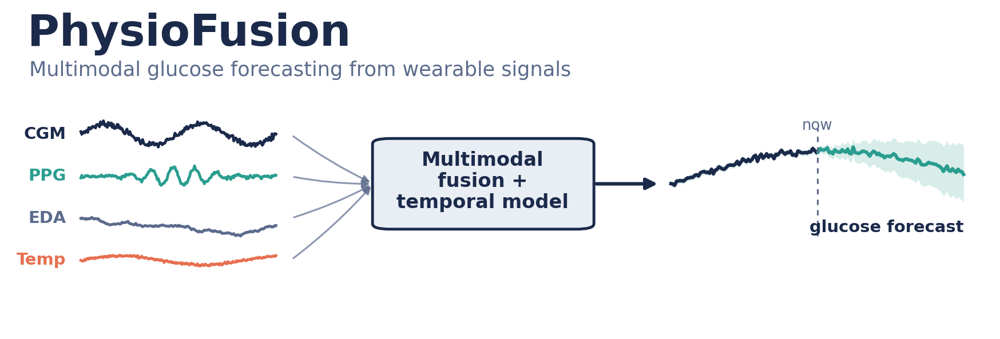

# PhysioFusion

**Do wrist-worn sensors add glucose information? A leakage-controlled test of multimodal sensor fusion.**



PhysioFusion is a Python library for building ML datasets from multimodal physiological signals and evaluating models on them without subject leakage. It is applied here to 30-minute glucose forecasting from a Dexcom G6 CGM paired with an Empatica E4 wristband (PPG, EDA, skin temperature, accelerometry).

📄 **Preprint:** Seyedebrahimi, Ojeda, Zarrintaj. *A Leakage-Controlled Evaluation of Multimodal Sensor Fusion for Wrist-Worn Glucose Estimation.* medRxiv, 2026. [doi:10.64898/2026.08.03.26359550](https://doi.org/10.64898/2026.08.03.26359550)

## Key results

5-fold subject-grouped cross-validation, 15 participants ([BIG IDEAs Lab dataset](https://physionet.org/content/big-ideas-glycemic-wearable/)), RMSE in mg/dL, 30-minute horizon:

| Experiment | RMSE (mg/dL) |
|---|---|
| CGM history only (linear regression) | **13.90 ± 0.58** |
| CGM + wrist summary features | 13.56 → 13.60 (no gain) |
| Early-fusion TCN, CGM + wrist sequences | 14.66 → 14.68 (no gain) |
| Wristband only | 22.58 |
| Time of day only | 22.63 |
| Predict training mean | 22.76 |

- Linear regression matches gradient-boosted trees, a fully convolutional network and a TCN on CGM history. This points to an information ceiling, not a modelling limit.
- Adding wrist signals does not improve forecasts, and wristband-only estimation is no better than time of day or the mean.
- **Takeaway:** in this normoglycemic cohort, wrist signals carry no glucose information beyond the cohort mean. Sensor fusion cannot recover information the sensor does not acquire.

## What's in the library

| Module | Purpose |
|---|---|
| `physiofusion.windowing` | Gap-aware CGM segmentation; history/horizon windows (2 h history → 30 min ahead) |
| `physiofusion.features` | Load E4 signals and align them to the CGM grid; HRV features from inter-beat intervals |
| `physiofusion.data.multimodal` | Build tabular and sequence (multi-channel) datasets; save to Parquet / NumPy |
| `physiofusion.splits` | **Subject-grouped splitting**: every subject is in exactly one fold |

Experiment scripts (baselines, model comparison, confound check, FCN/TCN, early fusion) are in [`tracks/track2_estimation/`](tracks/track2_estimation/).

## Leakage control

Random window-level splits let the same person appear in both training and test data, which inflates results for physiological signals. Here, every split goes through `subject_grouped_split`, and [`tests/test_splits.py`](tests/test_splits.py) asserts that no subject appears in both train and test and that no subject is lost.

The **confound check** compares wristband features against a time-of-day-only model on identical windows and folds, to separate real physiology from circadian patterns.

## Quickstart

```bash
conda env create -f environment.yml
conda activate physiofusion
pytest
```

Download the [BIG IDEAs Lab Glycemic Variability and Wearable Device Data](https://physionet.org/content/big-ideas-glycemic-wearable/) (v1.1.2) into `Data/` (git-ignored). Then run the experiments, for example:

```bash
python tracks/track2_estimation/model_compare.py      # linear / ridge / lasso / elastic net, 5 folds
python tracks/track2_estimation/confound_check.py     # wristband vs. time of day vs. mean
python tracks/track2_estimation/tcn_multimodal.py     # early-fusion TCN
```

## Roadmap

- Track 1: CGM forecasting on larger cohorts (e.g. OhioT1DM)
- Track 3: optical-spectral glucose modelling
- Conformal prediction intervals for uncertainty

## Tech

Python · PyTorch · scikit-learn · pandas · NeuroKit2 · pytest
